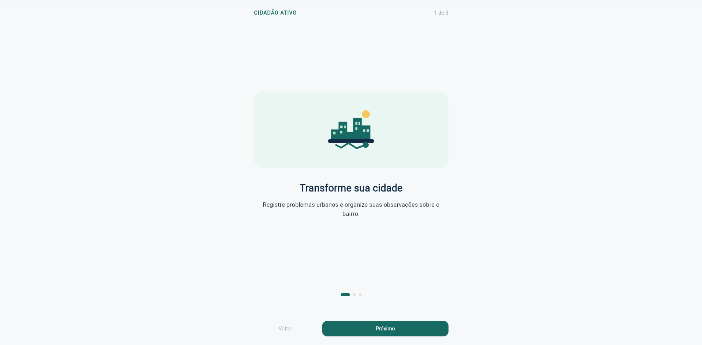
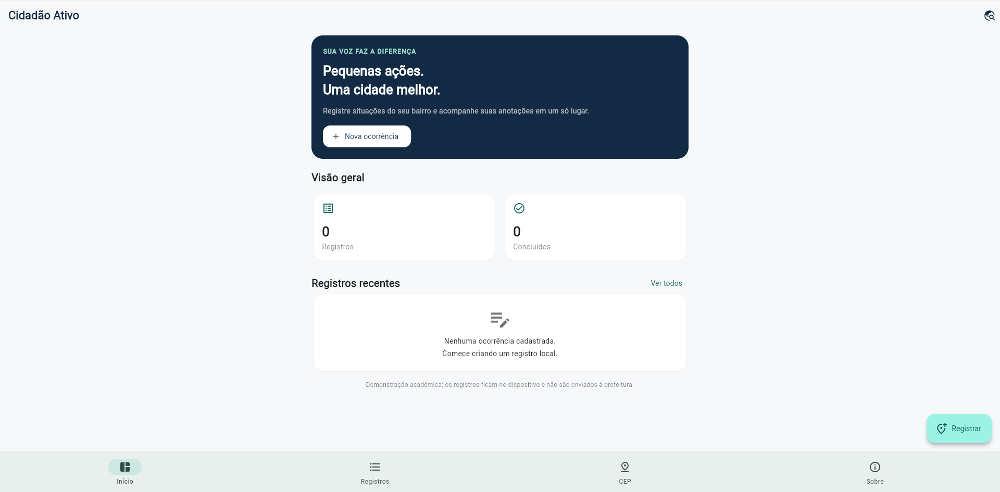
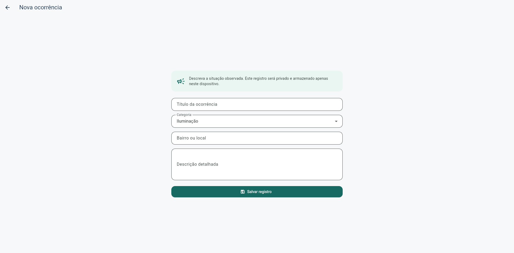
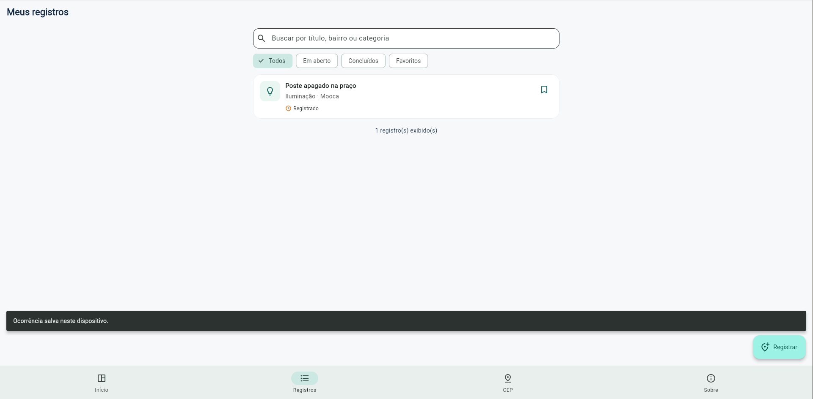
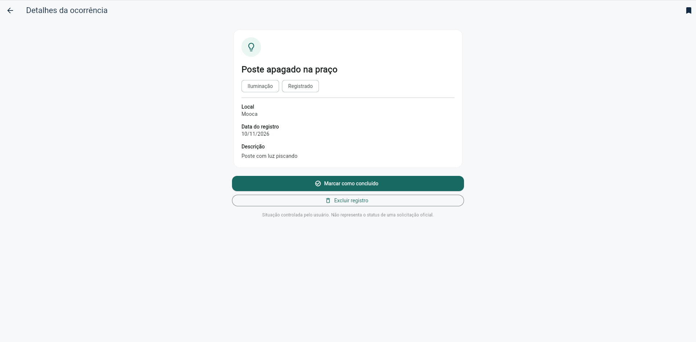
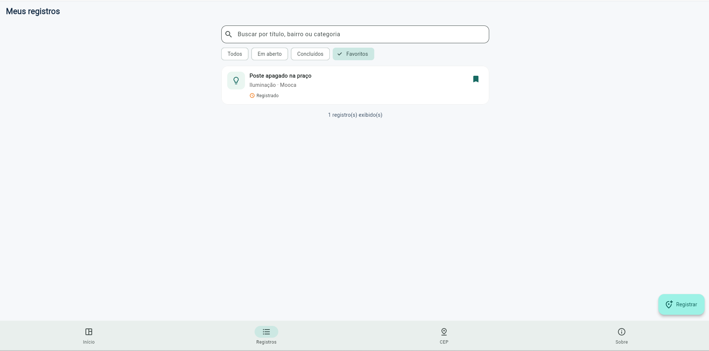
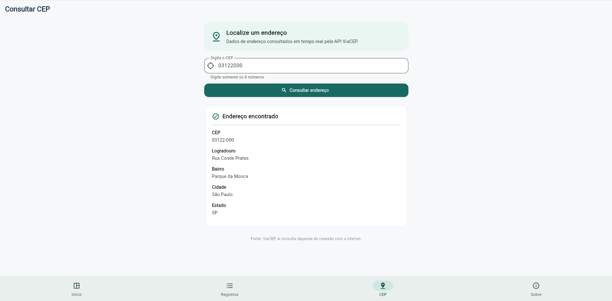
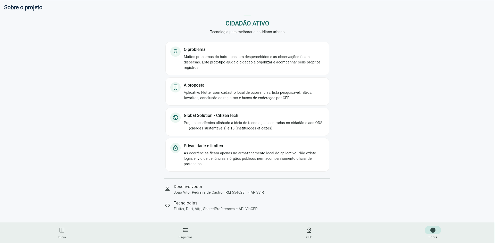

# Cidadão Ativo — Global Solution 2026.2

**Disciplina:** Desenvolvimento Cross Platform  
**Turma:** 3SIR — FIAP  
**Desenvolvedor:** João Vitor Pedreira de Castro  
**RM:** 554628

## 1. Descrição da solução

O **Cidadão Ativo** é um aplicativo desenvolvido em Flutter/Dart para registrar e acompanhar, de forma **local**, observações sobre problemas urbanos, como falhas de iluminação, buracos nas vias, limpeza e acessibilidade. O usuário pode cadastrar ocorrências, consultar detalhes, pesquisar, filtrar, favoritar, marcar registros como concluídos e excluí-los. Uma integração com a API ViaCEP permite consultar endereços a partir do CEP.

O projeto integra o desafio **CitizenTech** da Global Solution 2026.2 e está alinhado aos **ODS 11 — Cidades e Comunidades Sustentáveis** e **ODS 16 — Paz, Justiça e Instituições Eficazes**. A proposta é facilitar a organização de informações sobre situações observadas nos bairros.

> **Escopo do protótipo:** os registros são salvos no dispositivo/navegador do usuário. O aplicativo não envia denúncias à prefeitura, não cria protocolos oficiais e não confirma a resolução de problemas públicos. O status de conclusão é controlado pelo próprio usuário.

## 2. Funcionalidades

- **Splash:** exibe a identidade do aplicativo e direciona para a tela correta conforme preferência salva.
- **Onboarding:** introdução em três páginas, com avançar/voltar e opção “Não mostrar novamente”, persistida via SharedPreferences.
- **Início:** apresenta resumo e atalhos para visualizar ou criar ocorrências.
- **Registros:** lista de ocorrências, pesquisa por texto e filtros (todos, em aberto, concluídos e favoritos).
- **Nova ocorrência:** formulário com título, categoria, local e descrição.
- **Detalhes:** visualização de uma ocorrência selecionada, com ações para favoritar, concluir ou excluir.
- **Consulta CEP:** busca de endereço pela API ViaCEP, com estados inicial, carregamento, sucesso e erro, além de opção para tentar novamente.
- **Sobre:** apresenta objetivos, escopo, tecnologias e informações do projeto.

**Quatro telas principais na navegação inferior:** Início, Registros, CEP e Sobre. As alterações de interface são gerenciadas com `setState` e os dados locais são persistidos com `SharedPreferencesAsync`.

## 3. Fluxo de telas

```text
Splash
  ├─ Primeiro acesso / preferência não marcada → Onboarding (3 páginas) → Início
  └─ Preferência "Não mostrar novamente" ativada ────────────────────→ Início

Início
  ├─ Registros → Detalhes → Favoritar / Concluir / Excluir
  ├─ Nova ocorrência → Salvar → Registros
  ├─ Consultar CEP → Resultado / Erro → Tentar novamente
  └─ Sobre
```

## 4. Tecnologias e arquitetura

- **Flutter e Dart:** aplicativo multiplataforma e componentes visuais Material Design 3.
- **Pacote `http`:** requisições HTTP à API REST.
- **Pacote `shared_preferences`:** persistência local das ocorrências e da preferência de introdução.
- **Widgets reutilizáveis:** cartão de ocorrência e componentes de interface.

```text
lib/
  main.dart          Entrada do aplicativo
  models/            Modelos e conversão JSON (Issue, Address)
  services/          HTTP, armazenamento e preferências
  screens/           Telas do aplicativo
  widgets/           Componentes reutilizáveis
  theme/             Cores e estilos
assets/images/       Imagens do aplicativo
evidencias/          Capturas reais das telas
test/                Testes de modelos, WebService e widgets
android/             Arquivos da plataforma Android
web/                 Arquivos da plataforma Web
```

## 5. API REST — ViaCEP

**API:** [ViaCEP](https://viacep.com.br/)  
**Método:** `GET`  
**Endpoint:** `https://viacep.com.br/ws/{cep}/json/`  
**Exemplo:** `https://viacep.com.br/ws/01001000/json/`

O serviço valida o CEP, consulta o endpoint e transforma a resposta JSON em um objeto Dart (`Address`). A interface distingue os estados **inicial**, **carregando**, **sucesso** e **erro**, exibe mensagens em caso de falha e permite repetir a consulta. Para usar a consulta, é necessária conexão à internet.

## 6. Evidências de execução

As imagens abaixo foram capturadas da aplicação em funcionamento no Google Chrome.

### 6.1 Introdução (Onboarding)



### 6.2 Início (Dashboard)



### 6.3 Cadastro de ocorrência



### 6.4 Registros e pesquisa



### 6.5 Detalhes da ocorrência



### 6.6 Favoritos



### 6.7 Consulta de CEP com retorno da API



### 6.8 Sobre o projeto



## 7. Como executar

**Pré-requisitos:** Flutter SDK, Google Chrome, acesso à internet para instalação de dependências e uso do ViaCEP. Para Android, é necessário configurar o SDK do Android.

No terminal, dentro da pasta `cidadao_ativo`:

```powershell
flutter pub get
flutter analyze
flutter test
flutter run -d chrome
```

No Windows também é possível utilizar o script:

```powershell
powershell -NoProfile -ExecutionPolicy Bypass -File .\scripts\PREPARAR_E_EXECUTAR.ps1
```

Para verificar a instalação do SDK, execute `flutter doctor`. Os testes estão na pasta `test/`.
